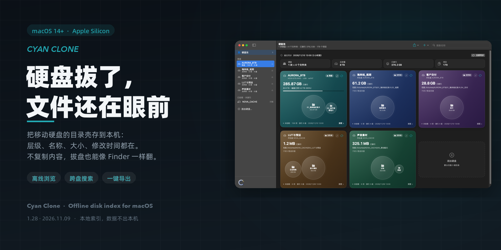
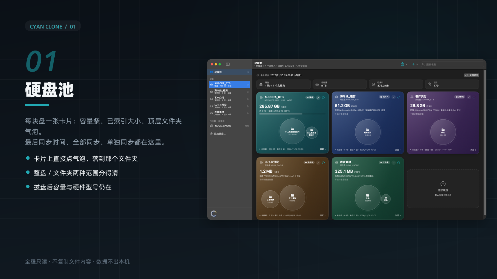
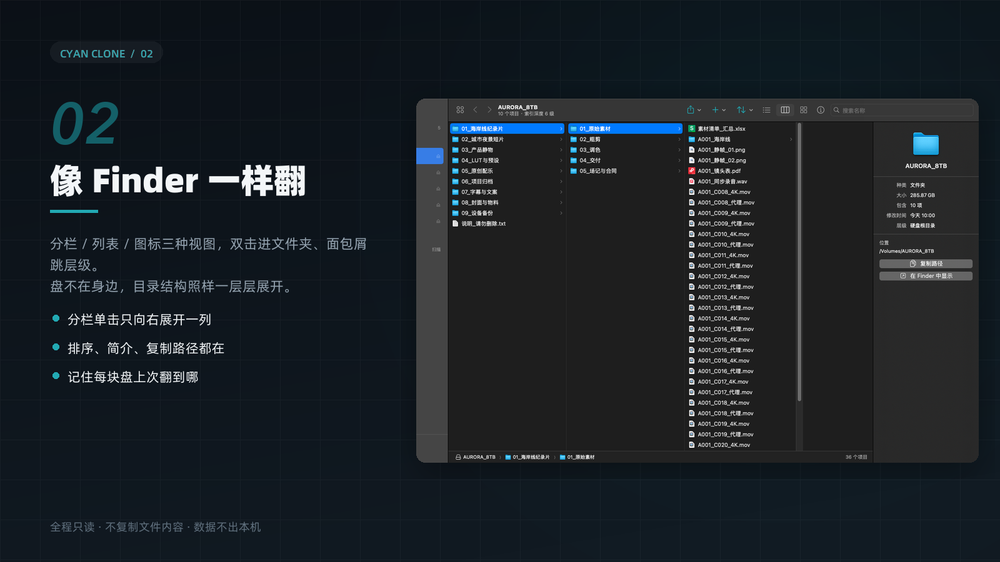
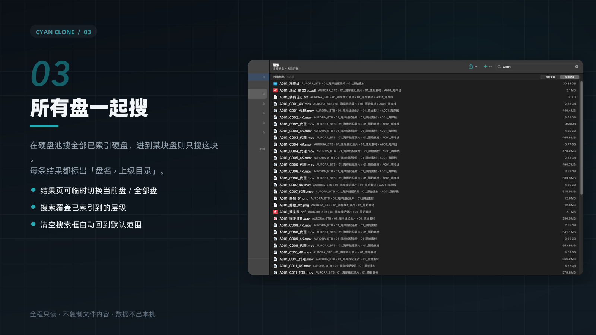
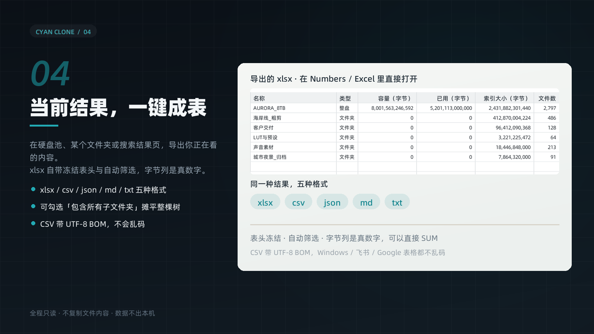
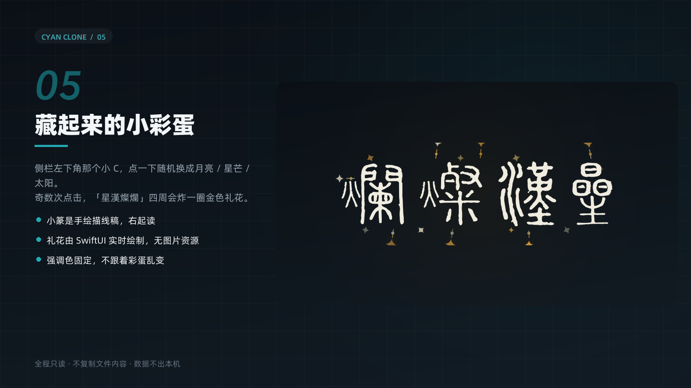
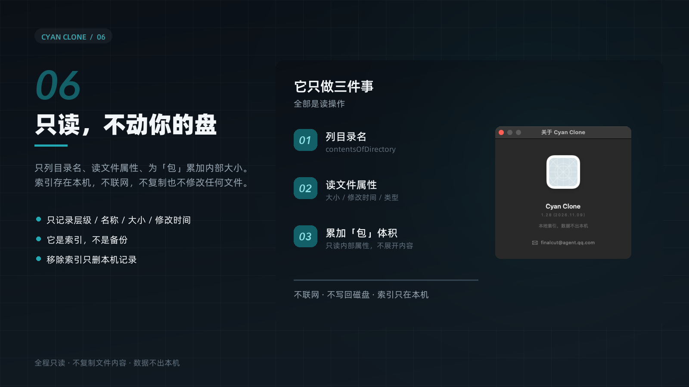

# Cyan Clone

> **Keep browsing your external drives after you unplug them — Cyan Clone saves only the directory shell, never the file contents.**

**Cyan Clone** is a tiny, read-only macOS utility that indexes the *directory shell* of your external drives — the folder hierarchy, file and folder names, sizes and modification dates — and stores it on your Mac without copying a single byte of file content. Once a drive is indexed, you can browse it like in Finder (column, list or icon view) and search across every indexed drive even when the disks are not plugged in. The home screen is a "drive pool" with one card per disk. It is written in Swift/SwiftUI, ships Sparkle for one-click auto-update, and all your data stays on your Mac. Requires macOS 14+ / Apple Silicon.

`macOS 14+` · `Apple Silicon` · `Swift / SwiftUI` · `内置自动更新` · `本地索引` · `v1.29 (2026.11.10)` · `全程只读`



**一句话定位：把移动硬盘的「目录壳」索引到本机，拔了盘也能像 Finder 一样翻目录、跨盘搜索，全程不复制文件内容。**

## 它解决什么

素材盘、项目盘堆在工作室，人一出门就断片：想确认「去年那个项目的素材在哪块盘、多大、哪天改的」，只能把盘一块块插上翻。剪辑师、摄影和后期手里往往好几块移动硬盘，文件名记不住、层级理不清，交接时也说不清盘里到底有什么。

整盘拷到本机太占空间，传云端又不放心。Cyan Clone 只留一份「壳」——层级、文件夹名、文件名、大小、修改时间——一份索引几 MB，拔盘后照样能翻、能搜、能交清单。

> 它是**索引，不是备份**：双击文件不会打开它，原盘插着时才会在 Finder 里定位到它。

核心特性如下。

## 只存「目录壳」，不复制一个字节的文件内容



扫描时只记层级、文件夹名、文件名、大小和修改时间，不打开、不复制文件内容。首页是**硬盘池**：每块盘一张卡片，容量条、已用百分比、已索引大小、顶层文件夹气泡一览，点气泡直接落到那个文件夹。

卡片会标出是**整盘**还是**文件夹**范围（文件夹索引不显示整盘容量，避免误读），整盘索引的卡片排前面；顶部一行「最后同步」显示全部硬盘里最近一次同步的时间，右边是「全部同步」，每张卡片右上角也有自己的同步按钮。

## 拔了盘，也能像 Finder 一样翻



双击进文件夹、‹ › 返回前进（`⌘[` / `⌘]`）、`⌘↑` 上一层、底部面包屑跳到任意一级；点列标题按名称 / 修改日期 / 大小 / 种类排序，再点切换升降序。默认**分栏**视图，也能切列表和图标，选择会被记住。

分栏视图和 Finder 一致：单击文件夹只是往右展开下一列，窗口当前位置不变；想真正走进去就点面包屑，或切回列表视图双击。App 还会记住每块盘上次翻到哪、上次停在硬盘池还是浏览页。

## 跨盘搜索，忘了在哪块盘也能找



在**硬盘池**（没进任何盘）搜索，查的是所有已索引硬盘，结果里带「盘名 › 上级目录」；**进了某块盘**再搜，只查这块盘。结果页顶部有「当前硬盘 / 全部硬盘」切换，临时想跨盘找一下不用退回硬盘池。

搜索只覆盖已索引到的层级——深度设到几级，就搜到几级。

## 深度、同步与硬盘型号，都由你定

- **索引深度**默认 3 级，可选 **1–8 级**：全局默认在工具栏 ＋ →「默认扫描深度」；单块盘在侧栏右键或卡片菜单 →「**更改索引深度…**」，在弹出的小面板里选层级再确认。深度越大记录越全，但大盘扫得更久、索引更大；6 级以上面板里会先给出提示。最后一级的文件夹名字后带 `…`，点进去会提示「索引到这一层为止」。
- **同步**：卡片右上角 ⟳ 沿用上次的范围和深度直接重扫；菜单里可更改深度、改扫描范围、移除索引、在 Finder 中显示。顶部「全部同步」把所有已挂载的盘按各自范围排队重扫。
- **硬件信息**：扫描 / 同步时通过 IOKit 读出型号、总线（USB / PCIe / 内置）、介质（固态 / 机械）、文件系统、容量，例如 `Samsung PSSD T7 · USB · exFAT`，拔盘后依然保留。
- **自定义名称**：卡片铅笔按钮或右键 →「重命名显示名称…」，只改 App 里显示的名字，**不会重命名硬盘本身**，留空即恢复原名。

单次扫描最多收录 60 万条目，`.Spotlight-V100`、`.Trashes` 等系统噪声目录自动跳过；扫描全程在后台队列跑，界面不卡。

## 导出当前结果，用 `.cyan` 整包搬家



工具栏 ↑（或 文件 →「导出当前结果…」，`⇧⌘E`）导出的是**你当前所在页**：硬盘池导出每块盘一行汇总，某个文件夹导出这一层（勾「包含所有子文件夹」可摊平整棵树），搜索结果导出命中的每一条并附所在位置。

列一律是 名称 / 种类 / 大小（字节）/ 大小 / 修改日期 / 项数 / 路径；**大小有两列是故意的**——字节列是纯数字，Excel 里可直接 `SUM`，可读那列给人看。

| 格式 | 适合 |
| --- | --- |
| **Excel（.xlsx）** | 交给客户、做统计、透视；表头冻结 + 自动筛选 + 列宽按内容 |
| **CSV（.csv）** | 通用互换；带 UTF-8 BOM，Excel / Numbers / 飞书表格 / Google 表格不乱码 |
| **JSON（.json）** | 再加工、喂脚本；带导出时间、来源、行数等元信息 |
| **Markdown（.md）** | 写文档、贴 Notion / GitHub，本身就是表格 |
| **纯文本（.txt）** | 粘聊天窗口、邮件；制表符分隔 |

xlsx 是按 OOXML 自己拼的（再用系统 `zip` 打包），没有引第三方库。换电脑用 `.cyan` 数据包：导出后得到一个以日期命名的文件（如 `Cyan-Clone-2026-11-10.cyan`），在新机器上**双击**即可导入（`⇧⌘I`），里面是全部硬盘的目录树、大小、修改时间、硬件型号 / 序列号、自定义名称和索引深度；合并时同一块盘比索引时间，新的覆盖旧的，本地更新则保留本地，本地改过的自定义名称不会被覆盖。

## 一点小彩蛋



侧栏左下角有个很小的 C。点一下，它会在**月亮 / 星芒 / 太阳**三个标记里随机换一个（只换这个 C，界面强调色固定青绿、App 图标也不跟着变），选择下次打开还记得。同时右边会浮出小篆「**星漢燦爛**」（繁体、右起，3 秒淡出）；第 1、3、5、7、9… 次这种**奇数次**点击，字四周还会炸一小圈金色礼花，偶数次只出字。

## 版本更新

菜单栏 **Cyan Clone → 关于 Cyan Clone** 里有一个「检查更新」按钮，走 [Sparkle](https://sparkle-project.org) 从 GitHub Releases 自动检查新版本，有新版就**自动下载并安装**；App 启动时也会在后台静默检查一次。

> 每次更新都有 **EdDSA 数字签名**，只有仓库所有者能发布新版本，别人推不了假更新。详见 [SECURITY.md](SECURITY.md)。

## 下载与安装

从 [Releases](../../releases) 下载最新版 DMG（`Cyan-Clone.dmg`），或直接点 **Assets** 里的 `Cyan Clone.app` / DMG。

1. 把 `Cyan Clone.app` 拖进「应用程序」。
2. 第一次打开若提示「无法验证开发者」：右键点 App → **打开**（绕过 Gatekeeper）。
3. 系统首次会问一次「是否允许访问可移除卷上的文件」，选**允许**。

> 仅支持 **macOS 14+ / Apple Silicon**。已内置 Sparkle 自动更新，装好后在「关于 → 检查更新」即可收到后续版本。

## 快速上手（3 步）

1. 点工具栏 **＋**（或 `⌘O`）→ 选中移动硬盘（默认定位到 `/Volumes`）→ **开始扫描**。
2. 扫完就出现在左侧栏和硬盘池里，可以继续加第二块、第三块盘。
3. 以后随时点进来看，**不用插盘**；想更新就点卡片右上角 ⟳ 同步，或顶部「全部同步」。

更完整的操作说明（深度、范围、搜索、快捷键、常见问题）见 **[USAGE.md](USAGE.md)**。

## 导出与 `.cyan` 搬家速查

| 想做什么 | 入口 | 结果 |
| --- | --- | --- |
| 导出当前页的清单 | 工具栏 ↑ / 文件 →「导出当前结果…」`⇧⌘E` | xlsx / csv / json / md / txt 五选一 |
| 把全部索引打包带走 | 工具栏 ↑ →「导出数据文件（.cyan）…」 | 一个以日期命名的 `.cyan` 文件 |
| 在新电脑导入 | 双击 `.cyan` / 文件 →「导入数据文件…」`⇧⌘I` | 按索引时间合并，新的覆盖旧的 |

## 隐私与只读承诺

**它只做读操作**：列目录名、读文件 / 文件夹属性（大小、修改时间、类型）、为 `.app` / `.fcpbundle` 这类「包」累加内部大小、通过 IOKit 查询硬件信息。



**它从不做**：不打开文件内容（因此不会改 atime、隔离属性或 Spotlight 索引）、不写 / 删 / 移 / 复制 / 改名任何文件、不申请管理员权限、不用 `sudo`、不执行外部命令、不跟随符号链接。**唯一的联网行为是「检查更新」时下载新版本**（只读不写、不上传任何本地数据）。

**写操作只有一处**：把索引存到本机 `~/Library/Application Support/Cyan Clone/index.json`（外加 App 自己的偏好设置）。「移除索引」只从这份 JSON 里删掉一条记录，硬盘上的文件一个都不动。**本地索引，数据不出本机。**

想自己验证：活动监视器里看写入应只有那个目录；`ls -lh ~/Library/Application\ Support/Cyan\ Clone/` 只有一个 `index.json`；退出 App 删掉这个文件夹就能彻底清掉痕迹。

## 从源码构建

需要 **Xcode 命令行工具**（Sparkle 框架已随仓库带上，无需额外下载）：

```sh
./build.sh          # 产出 Cyan Clone.app + Cyan-Clone.dmg（脚本还会打 Cyan-Clone.zip）
```

`build.sh` 会链接 `Vendor/Sparkle.framework` 并嵌入 App；手动编译时加上框架搜索路径：

```sh
swiftc -O -swift-version 5 -target arm64-apple-macos14.0 \
  -F Vendor -framework Sparkle \
  -Xlinker -rpath -Xlinker @executable_path/../Frameworks \
  -o CyanClone Sources/*.swift
```

> 自行分发时改 `build.sh` 里的 `SUFeedURL` 指向你自己的 appcast 即可。

版本号写在 `build.sh` 生成的 `Info.plist` 里（`CFBundleShortVersionString`）。也可以命令行单独扫一块盘、批量建索引：

```sh
"./Cyan Clone.app/Contents/MacOS/CyanClone" --scan /Volumes/MyDisk --depth 3 --out /tmp/mydisk.json
```

## 目录结构

顶层是 `build.sh`、`publish_update.sh`（发版生成签名 appcast）、`AppIcon.icns`、`Resources/`（品牌 SVG、小篆线稿）、`Sources/`、`Vendor/`（Sparkle 框架与签名工具）与 `README.md`。`Sources/` 主要文件：

```
Sources/
  Scanner.swift     深度受限的扫描器（只读元数据；包体积累加；60 万条目上限）
  Models.swift      节点 / 硬盘 / 排序模型
  Library.swift     索引库、导航、搜索、持久化
  ContentView.swift 窗口、工具栏、路径栏、搜索
  PoolView.swift    硬盘池：卡片、容量条、气泡装箱
  ListView.swift    列表视图
  ColumnView.swift  分栏视图 + 图标视图
  Sidebar.swift     侧栏 + 左下角的小 C（点击随机换标记）
  Brand.swift       品牌图形（C + 月亮/星芒/太阳，深浅两套画法）
  SealGlyph.swift   小篆字形（星/漢/燦/爛，骨架重绘）+ 右起排版
  Updater.swift     Sparkle 自动更新控制器
  Inspector.swift   简介面板
  Icons.swift       图标缓存与格式化
  KindName.swift    文件种类中文名
```

## 许可

[MIT](LICENSE) © 2026 CyanChung

## 联系作者

有问题、想加功能、或者用着不对劲：`finalcut@agent.qq.com`（App 里「关于」窗口最下面那行邮箱点一下，就能直接写信过来）。
